# MoDex · 轻量化 Markdown 编辑器

> 本地优先的 Markdown 桌面编辑器：编辑、实时预览、文件与文件夹管理，纯离线、无需账号。
> 界面采用 Codex 风格的单色设计语言：发丝线分区、精密排版、低装饰、键盘优先。
> 可选接入 **DeepSeek AI 写作助手**（右侧对话面板，Responses API，API Key 仅加密保存在本机）。
> 基于 Electron（渲染层零构建、零额外运行时依赖）。

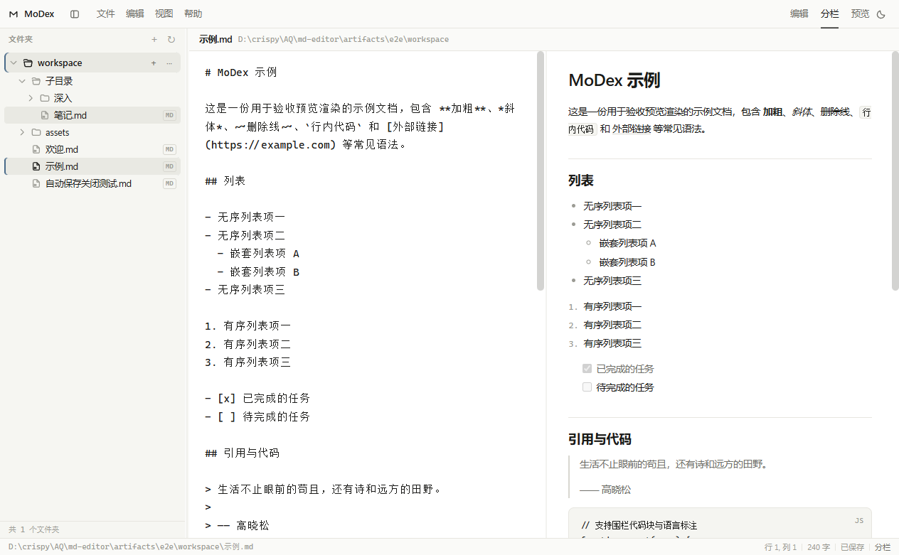

## 功能

| 分类 | 能力 |
| --- | --- |
| 导航 | **单条 40px 导航栏**：原生菜单栏已隐藏并合并进工具栏（文件/编辑/视图/帮助 自绘下拉 + 视图切换 + 主题），保留原生快捷键 |
| 预览样式 | **7 套内置 Markdown 预览样式**（Codex 极简 / GitHub / Vue / Notion / 飞书 / Tailwind Typography / 报刊衬线），「视图 → 预览样式」切换、持久化、重启恢复，深浅主题各自适配 |
| AI 助手（可选） | **右侧 AI 对话面板**：DeepSeek Responses API 流式对话、思考折叠、停止生成、错误重试、模型切换（deepseek-flash / deepseek-v4-pro）、当前文档上下文、快捷提问、本地会话历史；API Key 用系统密钥环加密存储、只在主进程使用（入口：工具栏 AI 图标 / `Ctrl+Shift+A`） |
| 自动保存 | **切换文件 / 新建 / 关闭文档 / 关闭软件时自动保存**：有路径静默写盘，未命名走另存为；保存失败或取消则中止操作、不丢数据（关闭软件不再弹保存询问） |
| 工作区 | **同时打开多个文件夹**（Codex 项目列表式侧栏）：文件夹可展开/折叠/切换、从列表移除（不删除磁盘文件）、启动时恢复上次打开的文件夹；每个文件夹独立监听外部变更 |
| 编辑 | Markdown 源码编辑、Tab 缩进、Enter 自动续写列表、加粗/斜体/链接/行内代码快捷键、查找（Ctrl+F） |
| 预览 | 实时渲染（标题/列表/任务列表/表格/引用/代码块/图片/链接）、标题锚点、编辑与预览按比例双向滚动同步 |
| 视图 | 编辑 / 分栏 / 预览三种模式，侧栏可拖拽显隐与调宽，编辑/预览分隔条可拖拽 |
| 文件 | 新建文档、打开文件（对话框/文件树/系统二次打开）、保存（Ctrl+S）、另存为（Ctrl+Shift+S）、关闭文档；工具栏精简为品牌/侧栏/视图/主题，操作入口保留在菜单与快捷键 |
| 数据安全 | 保存前比对磁盘 mtime，外部修改后提示「覆盖保存 / 重新加载 / 取消」，避免静默覆盖；未保存关闭/切换有确认 |
| 文件夹 | 打开文件夹、文件树按需展开、外部变更自动刷新（fs.watch） |
| 文件管理 | 新建 Markdown 文件、新建文件夹、重命名、删除到系统回收站（仅删空文件夹，带确认）、在资源管理器中显示、复制路径 |
| 体验 | 浅色/深色主题、字号缩放、最近打开记录、窗口位置记忆、未保存修改提醒、操作 toast 提示 |
| 安全 | IPC 来源校验（仅 app://bundle 主窗口）、contextIsolation、自定义 `app://` 协议、严格 CSP、无 Node 直连、Markdown 禁止原始 HTML、本地图片扩展名白名单 + 图片响应 CSP |

## 界面预览

| 分栏（浅色） | 分栏（深色） |
| --- | --- |
|  | 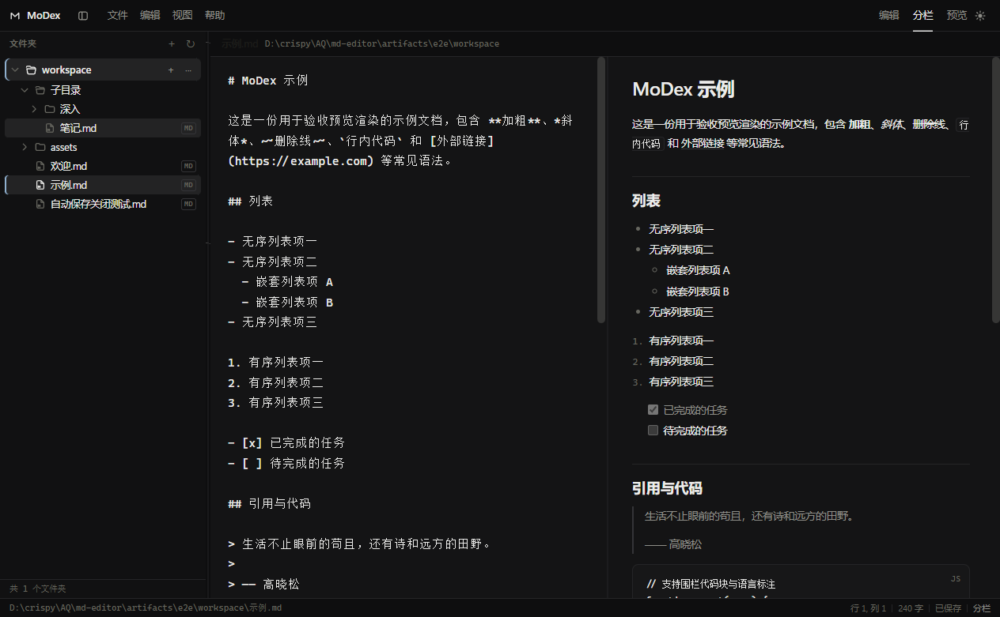 |

| 预览模式 | 右键菜单 |
| --- | --- |
| 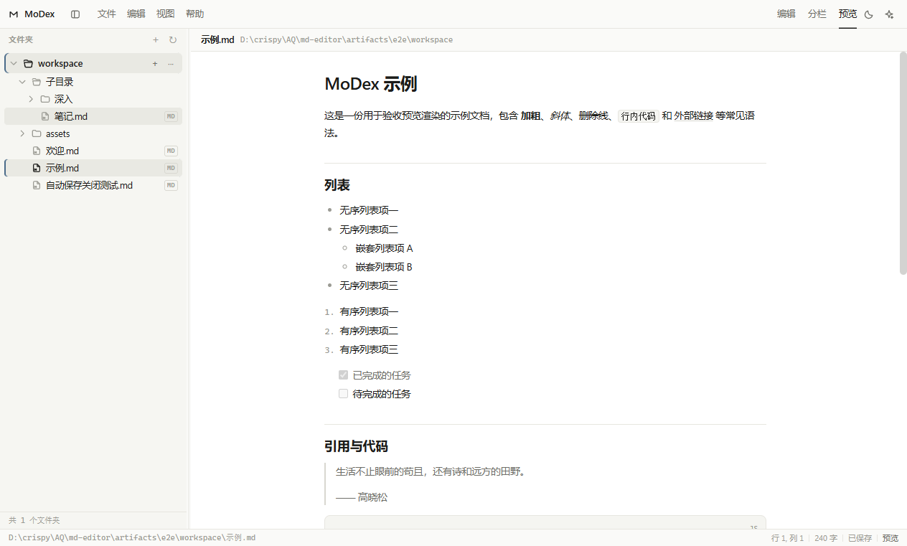 | 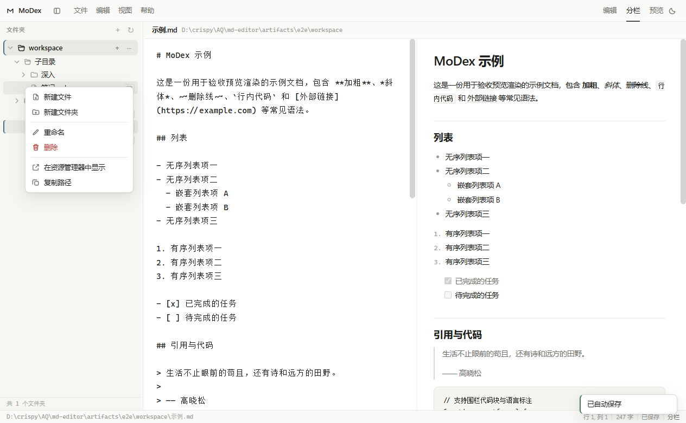 |

| 欢迎页 | 最小窗口 900×600 |
| --- | --- |
| 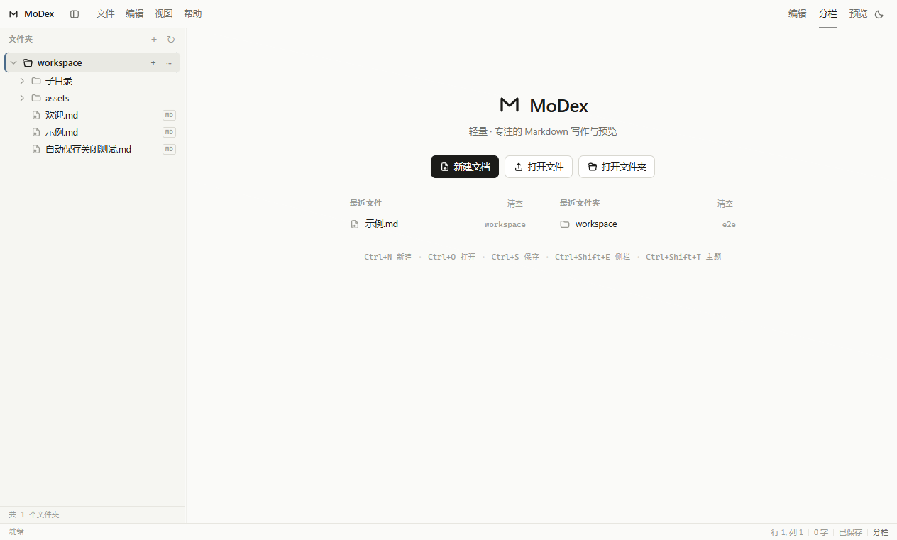 | 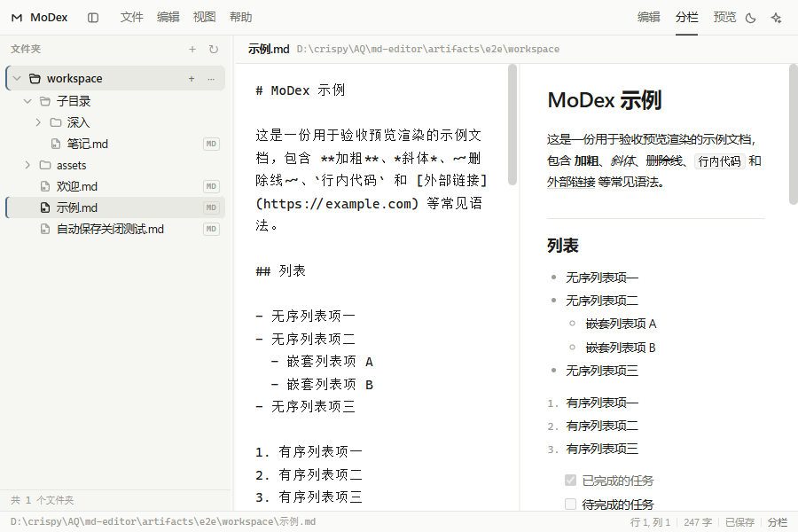 |

| 查找（浮层） | 未保存状态 |
| --- | --- |
| 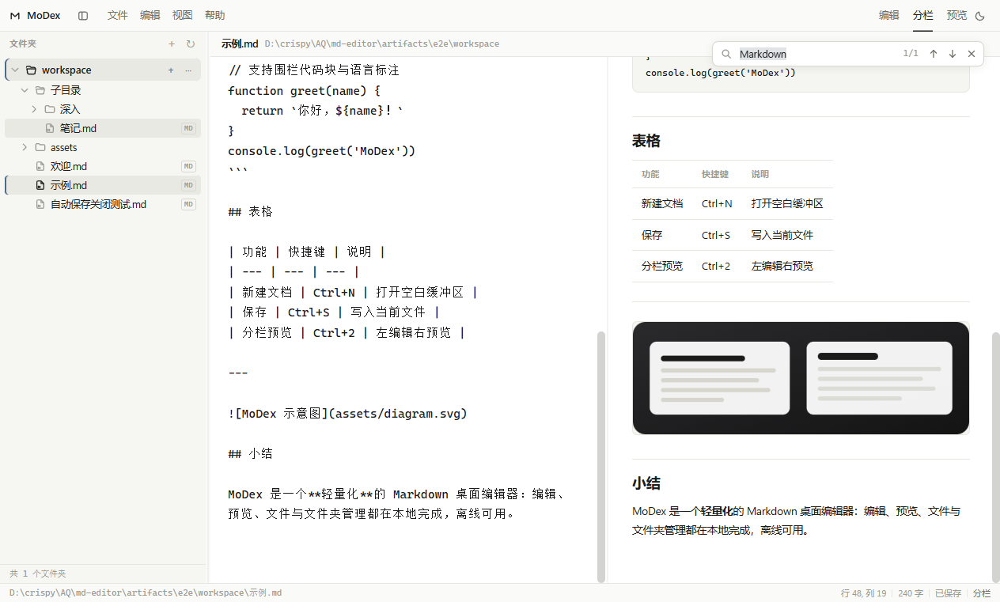 | 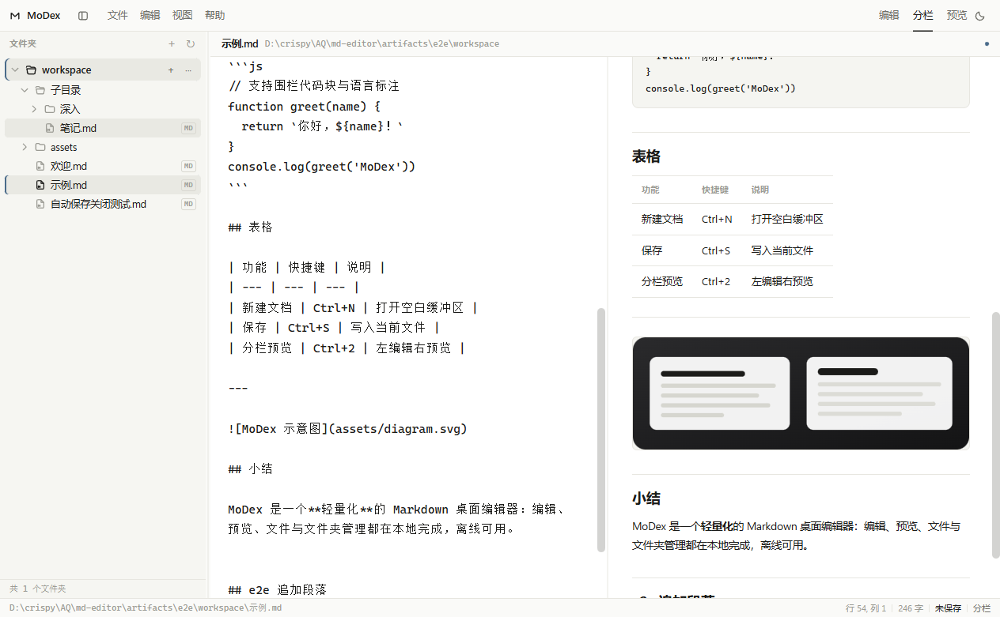 |

| 多文件夹工作区（Codex 项目列表式） | 文件夹根菜单 |
| --- | --- |
| 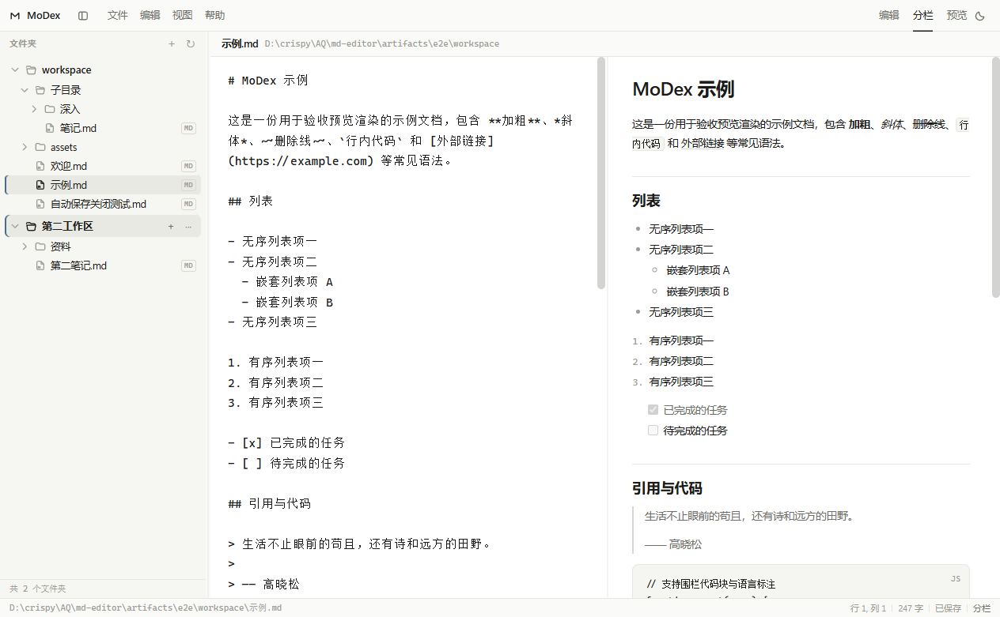 | 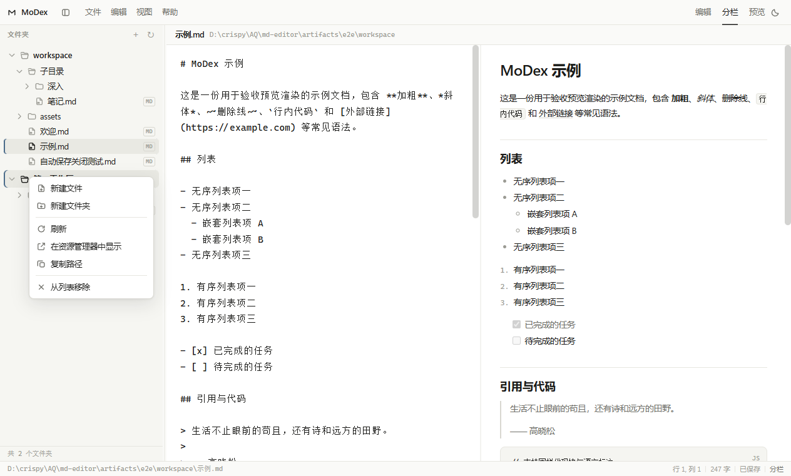 |

| 单条导航栏 + 应用菜单 | 单条导航栏全貌 |
| --- | --- |
| 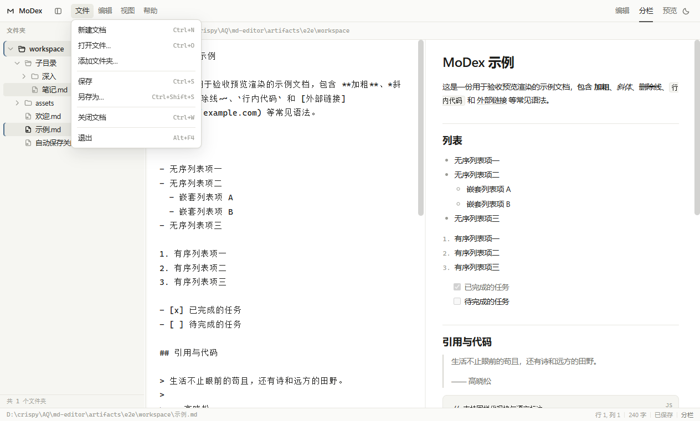 |  |

| 预览样式菜单（7 套） | GitHub 文档风 |
| --- | --- |
| 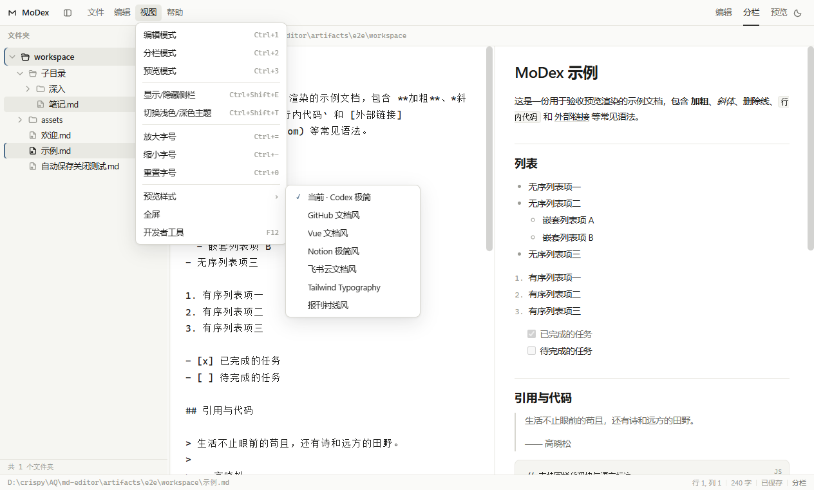 | 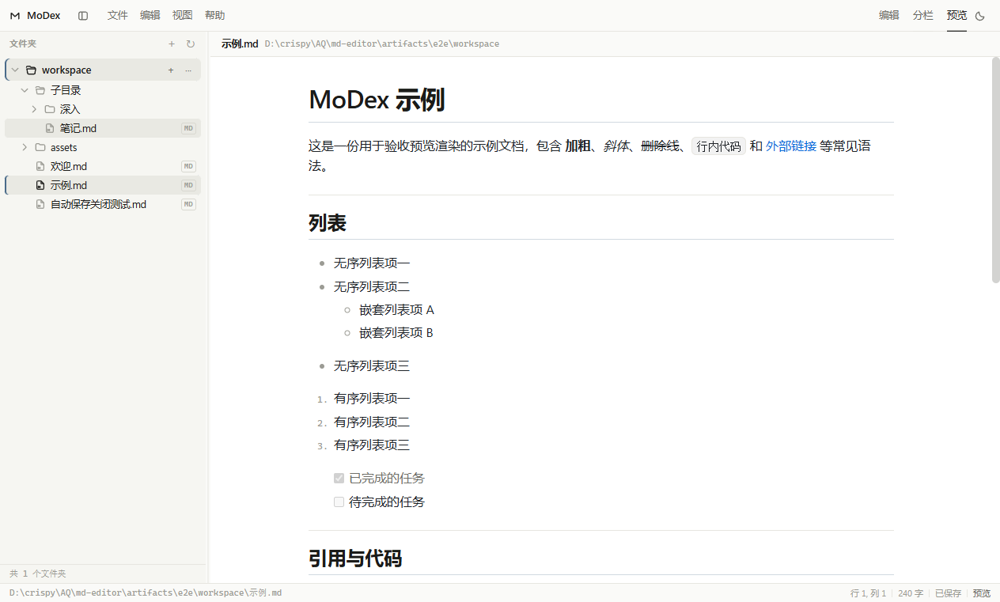 |

| 深色 + Vue 文档风 |
| --- |
| 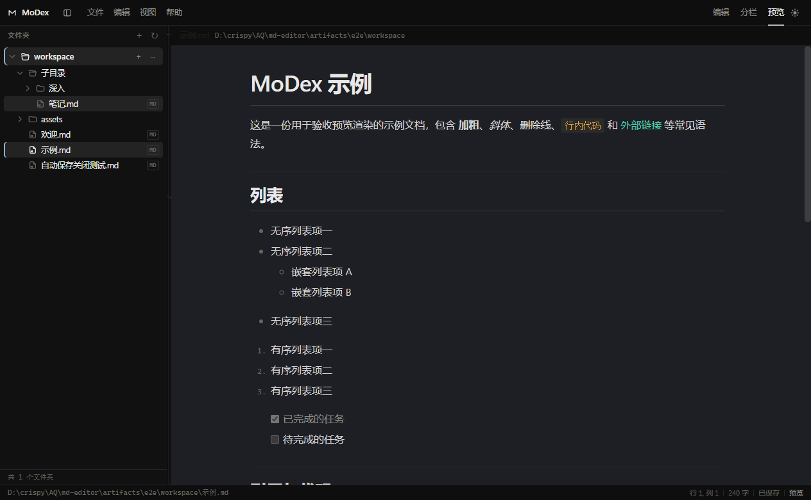 |

| AI 写作助手（浅色） | AI 写作助手（深色，流式回答） |
| --- | --- |
| 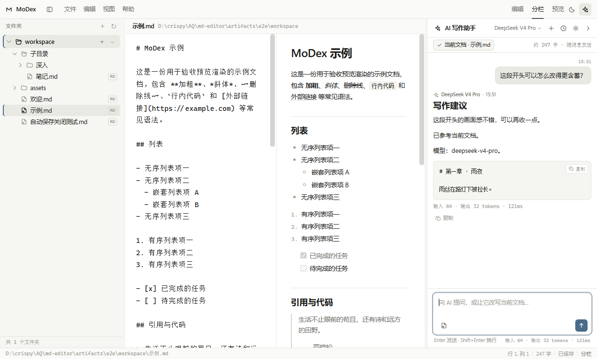 | 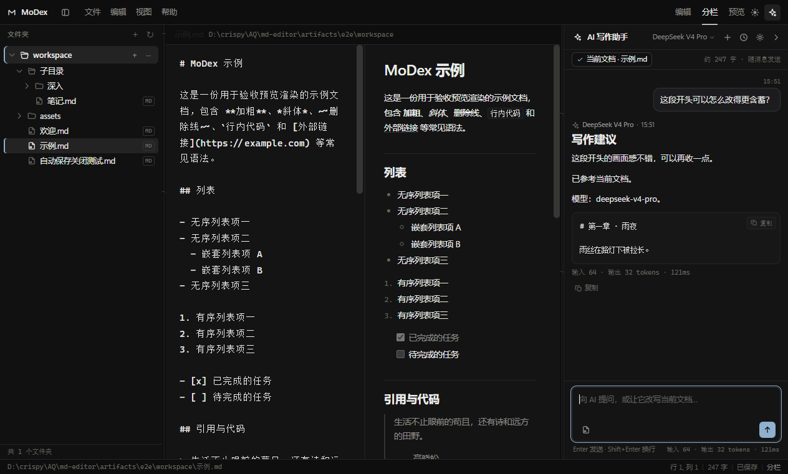 |

| AI 设置（API Key / 模型 / 连接测试） |
| --- |
| 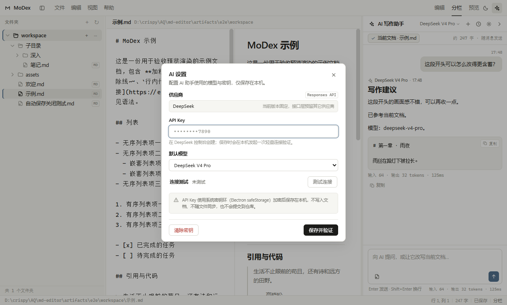 |

## 设计语言（Codex 风格）

- **单色体系**：黑白灰承担全部层级，仅一个低饱和石板蓝用于焦点/选中/链接，无彩色图标、无渐变、无发光。
- **单条导航栏**：隐藏 Windows 原生菜单栏，文件/编辑/视图/帮助 与品牌、视图切换、主题同处一条 40px 工具栏（应用菜单对象仍保留以维持原生快捷键）。
- **发丝线分区**：面板之间用 1px 边框而不是阴影；阴影只给右键菜单、查找栏、toast 等浮层。
- **精密排版**：UI 12.5px、微标签 10.5px 大写 + 0.08em 字距、路径与状态用等宽字体；树行 24px、状态栏 24px、工具栏 40px。
- **暖白/近黑中性色**：浅色为纸感暖白（`#fafaf8`），深色为近黑中性（`#0e0e0f`），整体低饱和。
- **克制微交互**：hover 仅 2–4% 明度浮起，激活项用左缘 2px 竖线或底部下划线，过渡 120ms ease-out；菜单/面板/消息出现为
  ≤200ms 的轻量淡入/滑入，侧栏与 AI 面板开合有 190ms 列宽过渡，按钮按压 90ms `scale(.97)`；`prefers-reduced-motion` 时全部关闭。
- **默认窗口比例**：1280×800（16:10），贴近 Codex 桌面窗口的宽高比例；用户调整后仍记忆恢复。
- 完整设计规范见 [docs/CODEX-UI-DESIGN.md](docs/CODEX-UI-DESIGN.md)。

## 运行

```powershell
cd md-editor
npm install      # 首次安装 electron（开发依赖）与 markdown-it（仅用于生成 vendor 文件）
npm start        # 启动应用
```

> `npm start` 通过 `scripts/start.mjs` 拉起 Electron，并会清除继承的 `ELECTRON_RUN_AS_NODE`
> 环境变量，避免 Electron 被当成 Node 解释器执行。

## AI 写作助手（可选，需自备 DeepSeek API Key）

- 打开：工具栏右侧 AI 图标或 `Ctrl+Shift+A`（也可从「视图 → AI 写作助手」）；面板可拖拽宽度、收起为 40px 侧条。
- 首次使用：点面板 header 的齿轮 → 粘贴 [DeepSeek API Key](https://platform.deepseek.com/api_keys) → 「保存并验证」；
  Key 使用系统密钥环（Electron `safeStorage` / Windows DPAPI）加密后保存在本机 `userData/ai/api-key.bin`，
  **不会写入文档、不会进仓库、日志不记录**，渲染层只能看到掩码后的 `••••••••xxxx`。
- 模型：`deepseek-flash`（默认，快）/ `deepseek-v4-pro`（更强推理）可在面板内切换。
- 能力：多轮对话、流式回答、思考过程折叠、停止生成、错误重试、Markdown/代码块渲染与复制、快捷提问
  （总结当前文档 / 生成大纲 / 润色选区）、当前文档上下文开关、本地会话历史（最多 200 个）。
- 网络与隐私：所有请求由主进程通过 Electron `net.fetch` 发出（走系统代理），渲染层没有网络权限；
  只有打开「当前文档」上下文开关（或快捷提问）时才会把当前文档内容发给 DeepSeek，单次最多 20k 字符。
- 未配置 Key 时应用完全离线可用，AI 面板会引导配置；测试/CI 使用本地 mock SSE 服务，不需要真实 Key。

## 打包便携版

```powershell
npm run package
# 产物：release/MoDex-1.0.0-win32-x64/MoDex.exe
```

打包脚本复用 `node_modules/electron/dist` 已解压的运行时，把 `src/` 与 `assets/` 放进
`resources/app/`，无需 electron-builder、无需联网下载，产物为绿色免安装目录，双击 exe 即用。

## 生成 Windows 安装包

```powershell
winget install JRSoftware.InnoSetup   # 首次：安装 Inno Setup 6（仅构建机需要）
npm run installer
# 产物：release/MoDex-1.0.0-setup.exe（约 98 MB）
```

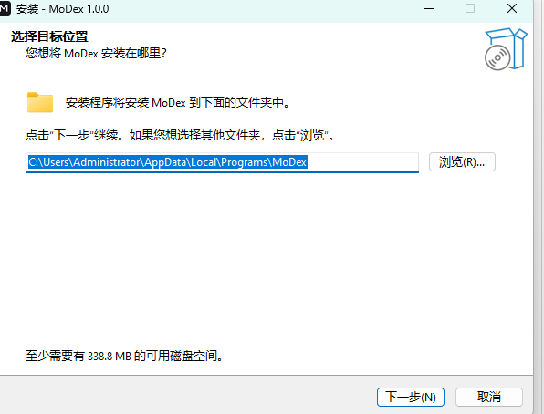

- 按用户安装到 `%LOCALAPPDATA%\Programs\MoDex`，**无需管理员权限**；创建开始菜单/桌面快捷方式与标准卸载程序；
- 升级使用固定 AppId 覆盖安装；**卸载保留** `%APPDATA%\MoDex`（设置、AI 会话与加密后的 API Key），重装自动恢复；
- 安装包未签名，首次运行 SmartScreen 可能提示「未知发布者」；详细说明、构建参数与验证记录见
  [docs/INSTALLER.md](docs/INSTALLER.md)。
- 已用「安装 → 已安装 exe 跑完整两阶段 smoke（141/141 + 阶段二）→ 静默卸载」验证清理干净。

## 测试与验收

```powershell
npm test                                   # 单元测试：fs-service / state-store / AI 协议与会话 / 安全回归（86 项）
npm run smoke                              # 两阶段端到端验收：界面断言 141 项 + 关闭自动保存
npm run smoke -- --app "release/MoDex-1.0.0-win32-x64/MoDex.exe"   # 验收打包产物
```

`npm run smoke` 会：

1. 在 `artifacts/e2e/workspace/` 生成一套示例 Markdown 工作区（含图片、子目录、表格、任务列表）；
2. 用隔离的 `--user-data` 启动应用，执行 `src/main/e2e.js` 中的端到端驱动；
3. 验证初始化、文件树展开/点击打开、打开文档、Markdown 渲染（含 `app://file` 本地图片）、三种视图、深浅主题、
   全局快捷键、查找栏、编辑保存落地、右键菜单、侧栏 UI 新建文件、新建文件/文件夹、刷新、重命名、删除到回收站、
   最小窗口布局、设置持久化、**AI 面板（本地 mock Responses 服务）**等 **141 项断言**（含多文件夹工作区、精简工具栏、
   单条导航栏与应用菜单、自动保存、7 套预览样式切换、AI 流式/停止/错误/历史/上下文）；
4. 第二阶段的关闭验证：再启动一次应用，打开文件 → 编辑 → 触发窗口关闭，断言**无保存询问**、进程正常退出且内容落盘；
5. 把截图写入 `artifacts/e2e/screenshots/`（稳定副本在 `docs/screenshots/`），结果写入 `artifacts/e2e/results.json`，
   两阶段全绿才返回 0。AI 部分通过 `--ai-base-url` 指向 `scripts/smoke.mjs` 启动的本地 mock 服务，不调用真实 API。

### 独立 QA 审计

`docs/QA-REPORT.md` 是独立 QA 成员的验收报告：需求覆盖证据表、安全审计（CSP 实测、7 类 XSS 载荷、
40 项路径/文件名边界、`app://` 协议 22 项、原生对话框 6 项）、健壮性边界与缺陷分级。
累计通过 **500 项**检查（86 单测 + 141 端到端 + 30 AI 助手专项 + 20 预览样式专项 + 24 单条导航栏专项 +
100 CDP 运行时审计 + 23 更名/设计还原 + 18 多文件夹专项 + 17 加固复验 + 14 自动保存专项 + 11 行内编辑竞态复验 +
16 微动效专项），
P0=0、P1=0；P2 中的「外部修改覆盖」「IPC 来源校验」「CSP 补全」「图片响应 CSP」「第二实例打开」已修复，
其余 P2 为不阻塞的后续建议。*（报告中的「轻墨」为更名前名称，即本产品 MoDex。）*
多文件夹、单条导航栏、自动保存、预览样式、AI 助手、微动效与安装包的验收见报告 §13/§14/§15/§16/§17/§18/§19；AI 实现契约见
`docs/AI-PANEL-SPEC.md`，设计稿见 `docs/mockups/`；7 套预览样式的调研对比见 `docs/MARKDOWN-STYLE-GALLERY.md`。

## 快捷键

| 快捷键 | 功能 | 快捷键 | 功能 |
| --- | --- | --- | --- |
| Ctrl+N | 新建文档 | Ctrl+S | 保存 |
| Ctrl+O | 打开文件 | Ctrl+Shift+S | 另存为 |
| Ctrl+W | 关闭文档 | Ctrl+F | 查找 |
| Ctrl+1 / 2 / 3 | 编辑 / 分栏 / 预览 | Ctrl+Shift+E | 显示/隐藏侧栏 |
| Ctrl+Shift+T | 切换主题 | Ctrl+= / - / 0 | 放大 / 缩小 / 重置字号 |
| Ctrl+B | 加粗（编辑器内）/ 侧栏（编辑器外） | Ctrl+I | 斜体 |
| Ctrl+K | 插入链接 | Tab / Shift+Tab | 缩进 / 反缩进 |
| Ctrl+Shift+A | 打开 / 收起 AI 写作助手 | Esc | 关闭查找栏 / 菜单 / AI 面板 |
| Enter | 自动续写列表 | | |

## 目录结构

```text
md-editor/
├── assets/                 应用图标（icon.ico 由 scripts/make-icon.py 生成）
├── docs/                   接口契约、渲染层规格、Codex 风格设计规范、QA 报告、截图
├── scripts/                启动器、端到端验收、便携版打包、图标生成
├── src/
│   ├── main/               主进程：窗口/IPC/菜单/文件服务/状态存储/app 协议/端到端驱动
│   │   └── ai/             AI 服务：provider 注册表 / Responses 客户端 / SSE 解析 / 会话与 Key 存储
│   ├── preload/            预加载：contextBridge 暴露 window.api（含 api.ai）
│   └── renderer/           渲染层：原生 ES Modules（零构建），vendor 内置 markdown-it
└── tests/                  node:test 单元测试（含 QA 回归用例）
```

## 安全设计

- 渲染层 `contextIsolation: true`、`nodeIntegration: false`，只能通过 `window.api` 访问受控能力；
- 所有 IPC 通道校验来源：仅接受主窗口 `webContents` 且 `senderFrame.url` 为 `app://bundle/` 的调用，其余返回 `EACCES`；
- 页面通过自定义协议 `app://bundle/` 加载并附带严格 CSP（`script-src 'self'`、`object-src 'none'`、
  `base-uri 'none'`、`frame-ancestors 'none'`、`form-action 'none'`，禁止内联脚本与远程资源）；
- 本地图片经 `app://file/` 代理，仅允许图片扩展名、限制 30 MB、必须绝对路径，响应带 `CSP: default-src 'none'`；
- Markdown 渲染固定 `html: false`，预览只接受 markdown-it 输出，避免原始 HTML 注入；链接只允许 http/https 交给系统浏览器；
- 主进程对所有路径做绝对路径校验，文件名经非法字符/保留名/长度校验；文本读取限制 5 MB、强制 UTF-8；
- 删除只允许文件或空文件夹，并优先移入系统回收站；保存前比对 mtime，外部修改不会静默覆盖；
- **AI API Key 仅主进程持有**：`safeStorage` 加密存储、渲染层只能拿到掩码；AI 网络请求全部在主进程发出，
  渲染层 CSP 仍是 `connect-src 'self'`；AI 回答走与预览相同的 markdown-it（`html:false`），不会执行模型输出的 HTML/脚本。

## 已知限制

- 单文档编辑（无多标签页），未做协同/云同步；
- 查找不提供替换；暂不支持把文件拖入窗口打开（Electron 40 移除了 `File.path`，需改用 `webUtils.getPathForFile`）；
- 文本上限 5 MB，仅支持 UTF-8 编码；保存会去掉原文件的 UTF-8 BOM（契约未要求字节级原样）；
- `autoSave` 字段已在设置与契约中预留，但暂无 UI 开关（默认关闭）；
- 最近打开列表不自动清理已被外部删除的条目（点击时会提示失败）；
- 便携版沿用 Electron 默认可执行文件图标（窗口/任务栏图标已为 MoDex）；
- AI 助手为可选功能：v1 仅 DeepSeek 两个模型；不做图片/附件、联网搜索、自动插入文档、会话导出（后续版本）；
- 便携版目录约 330 MB 中，Electron/Chromium 运行时占 99% 以上，应用自身代码与资源不足 1 MB。

## 工程说明

- 渲染层零依赖、零构建：`src/renderer/vendor/markdown-it.min.js` 为内置第三方库（构建时从 `node_modules` 复制，仓库内固定资产），其余全部为原生 ES Module。
- 主进程只依赖 Node 内置模块与 Electron，因此打包无需携带 `node_modules`。
- 自定义协议 `app://bundle/` 提供 ES Module 与 CSP；`app://file/` 只代理图片扩展名，供预览本地图片。
- 端到端验收通过 CDP `Page.captureScreenshot` 截图（能包含右键菜单等浮层），失败时回退 `webContents.capturePage`。
- 更名说明：应用原名为「轻墨 / QingMo」，本版本更名为 **MoDex**；用户数据目录随产品名变为 `%APPDATA%\MoDex`。


