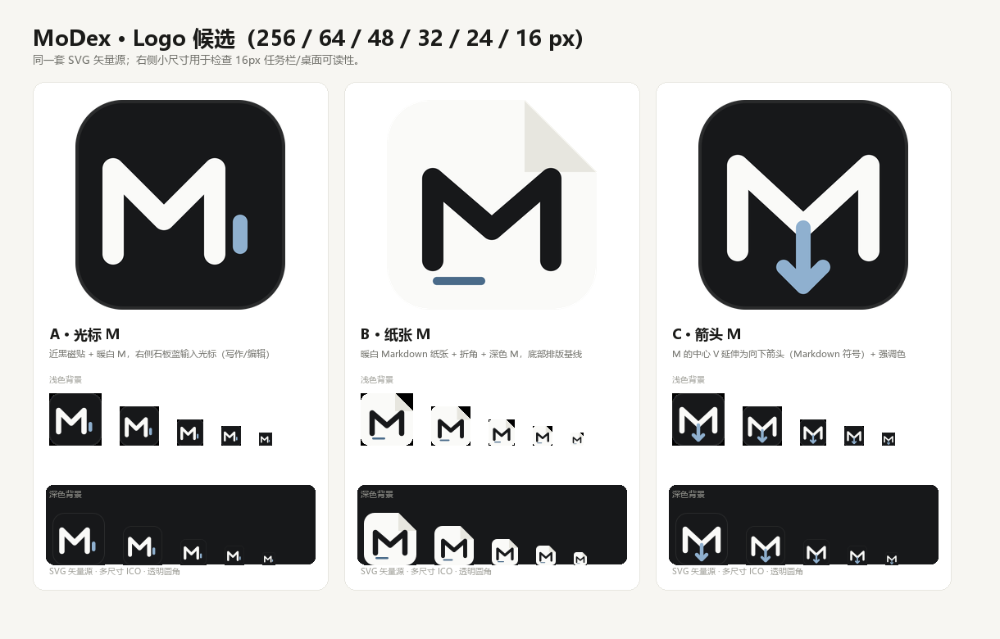

# MoDex Logo 与图标规范

> 目标：用一个可缩放的矢量 Logo 统一应用窗口、任务栏、桌面/开始菜单快捷方式、`MoDex.exe` 文件图标与安装包图标。


## 设计概念：光标 M

- **主体**：暖白 `#fafaf8` 的圆角几何 **M**，取自 MoDex 首字母，笔画端点圆角，保证 16px 仍清晰。
- **纸感磁贴**：近黑 `#17181a` 圆角方形（圆角 58/256），与 MoDex 的浅色暖白 / 深色近黑 UI 一致；内侧 8% 白色发丝描边让图标在深色任务栏上仍有边界。
- **石板蓝光标**：右侧一根 `#8fb0cf` 圆角竖条，象征文本输入光标（写作/编辑），也是整套 UI 唯一强调色 `#4a6b8a` 的深色主题对应值。
- 不用渐变、不用投影、不加文字，符合 Codex 风格的克制单色语言。

候选对比（A 为最终采用）：


- A · 光标 M（**采用**）：辨识度与 16px 可读性最好，延续现有 M 标记。
- B · 纸张 M：Markdown 纸张 + 折角，文档感更强，但浅色壁纸下磁贴边界较弱。
- C · 箭头 M：M 中心延伸为 Markdown 向下箭头，语义最直接，但小尺寸下元素容易糊在一起。

## 文件结构

```
assets/
├── logo/
│   ├── modex-logo.svg   # 最终 Logo 矢量源（单一真源）
│   ├── logo-a.svg       # 候选 A（= 最终方案）
│   ├── logo-b.svg       # 候选 B（纸张 M）
│   └── logo-c.svg       # 候选 C（箭头 M）
├── icon.ico             # 由脚本生成：16/24/32/48/64/128/256 多尺寸
└── icon.png             # 由脚本生成：256×256，用于文档/商店/README

scripts/
├── build-icons.mjs      # SVG → 多尺寸 PNG → ICO（sharp 栅格化 + Node 手写 ICO）
└── package.mjs          # 打包时用 rcedit 把 icon.ico 与版本信息写入 MoDex.exe
```

## 生成与替换

```powershell
npm run icons                      # 用 assets/logo/modex-logo.svg 重新生成 icon.ico + icon.png
npm run icons -- --candidates      # 渲染 assets/logo/*.svg 候选到 artifacts/logo-render/
npm run package                    # 打包并把 Logo/版本信息写入 release/.../MoDex.exe
npm run installer -- --skip-package  # 重新生成安装包（SetupIconFile=assets/icon.ico）
```

- SVG 源尺寸 256×256；`build-icons.mjs` 用 `sharp` 直接按目标尺寸栅格化，16px 图标不会因缩放模糊。
- ICO 采用 PNG 压缩条目（Windows Vista+ 支持），包含全部 7 个尺寸。
- 更换 Logo：替换/修改 `assets/logo/modex-logo.svg` → `npm run icons` → `npm run package && npm run installer`。

## 图标覆盖范围

| 位置 | 来源 | 说明 |
| --- | --- | --- |
| 应用窗口 / 任务栏 | `assets/icon.ico`（`main.js` BrowserWindow `icon`） | 运行时读取 |
| `MoDex.exe` 文件图标 | `rcedit` 写入 exe 资源 | 文件资源管理器、任务栏固定、开始菜单搜索 |
| 桌面 / 开始菜单快捷方式 | 安装包 `IconFilename={app}\MoDex.exe,0` | 安装时创建，指向已嵌入 Logo 的 exe |
| 安装向导 / 安装包 exe | `installer/MoDex.iss` 的 `SetupIconFile=..\assets\icon.ico` | 安装程序与卸载程序显示 Logo |
| 卸载列表图标 | `UninstallDisplayIcon={app}\MoDex.exe` | 控制面板/设置中的 MoDex 图标 |
| README / 文档 | `assets/icon.png` | 256×256 |

## 验证记录（本版本）

- `assets/icon.ico` 含 16/24/32/48/64/128/256 全部尺寸（Pillow/ICO 头检查通过）。
- `release/MoDex-1.0.0-win32-x64/MoDex.exe` 版本资源：
  `FileDescription=MoDex · 轻量化 Markdown 编辑器`、`FileVersion=1.0.0`、`ProductName=MoDex`、
  `ProductVersion=1.0.0`、`CompanyName=crispy-A`、`OriginalFilename=MoDex.exe`；
  提取其中图标为「光标 M」Logo（32×32 采样识别）。
- `release/MoDex-1.0.0-setup.exe` 图标同为 Logo；安装后开始菜单快捷方式
  `IconLocation=<安装目录>\MoDex.exe,0`，安装后 exe 图标为 Logo；安装后 exe 两阶段 smoke 通过。
- 注意：Windows 图标缓存可能导致覆盖安装后短暂显示旧图标，注销/重启资源管理器或重新固定快捷方式即可刷新。

> QA 独立验收记录见 `docs/QA-REPORT.md` §20。
